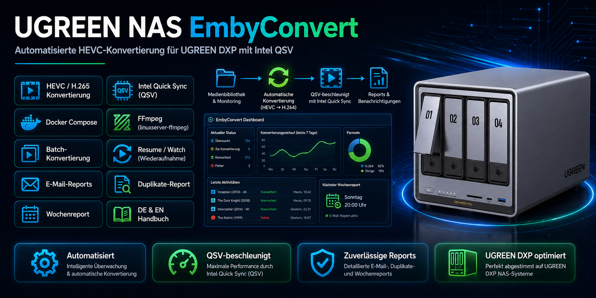
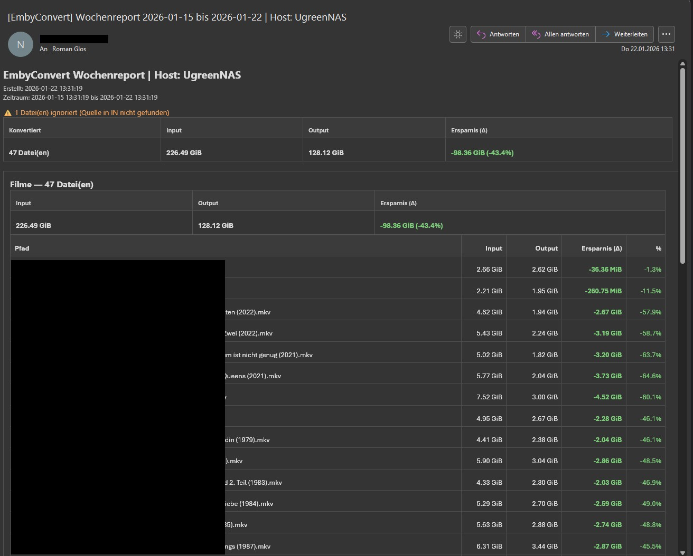
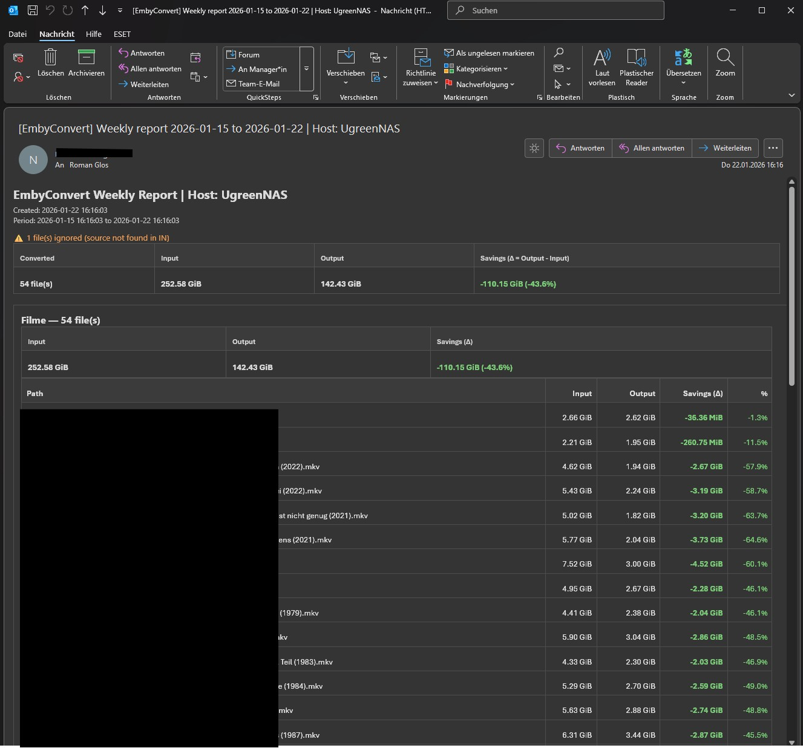

# EmbyConvert – UGREEN DXP NAS (Intel QSV)

[](https://github.com/Railsimulatornet/UGREEN-NAS-EmbyConvert/actions/workflows/quality.yml)
[](https://github.com/Railsimulatornet/UGREEN-NAS-EmbyConvert/actions/workflows/codeql.yml)
[](LICENSE)



[Deutsch](#deutsch) · [English](#english)

## Deutsch

EmbyConvert ist ein Docker-Paket für UGREEN-DXP-Systeme mit Intel-iGPU. Es konvertiert Medien nach HEVC (H.265) mit Intel Quick Sync und erstellt regelmäßige E-Mail-Reports. Deutsche und englische Pakete liegen getrennt in `de/` und `en/`.

### Funktionen

- Docker Compose für `lscr.io/linuxserver/ffmpeg:latest` mit Zugriff auf `/dev/dri`.
- Batch-Konvertierung über `hevc_batch.sh` mit Resume und Watch-Modus.
- Einstellbare Qualitäts-, Größen-, Audio- und Ausschlussregeln.
- Prüfung der temporären Ausgabedateien vor dem Übernehmen.
- Duplikate-Report und wöchentlicher HTML-Mailreport mit Python.
- Schreibgeschützter Eingabe-Mount im mitgelieferten Compose-Paket.
- Deutsche und englische Skriptpakete, PDF-Handbücher und Beispielreports.

### Voraussetzungen

- UGREEN DXP mit für Intel QSV nutzbarer Intel-iGPU und verfügbarem `/dev/dri`.
- Docker mit Compose beziehungsweise die UGOS-Docker-App.
- Passende Zugriffsrechte auf die GPU-Geräte, Eingabemedien, Skripte und den Ausgabeordner.
- Ausreichend freier Speicher im Ausgabeordner.
- SMTP-Zugang für den Wochenreport.

Die Pfade, Benutzer- und Gruppenwerte in Compose sind Beispiele und müssen zu deinem NAS passen.

### Schnellstart

1. Lade das passende deutsche oder englische ZIP unter [Releases](https://github.com/Railsimulatornet/UGREEN-NAS-EmbyConvert/releases/latest) herunter.
2. Kopiere den **Inhalt** von `de/EmbyConvert/` beziehungsweise `en/EmbyConvert/` direkt nach `/volume2/docker/EmbyConvert/` oder in deinen eigenen Zielordner.
3. Bearbeite dort `docker-compose.yaml`. Prüfe vor dem Start die Medien-, Ausgabe- und Skriptpfade in **beiden Services**, die GPU-Gruppen sowie die konfigurierten Benutzerwerte.
4. Trage SMTP-Zugang und Report-Einstellungen in `embyconvert_mail.env` ein. Diese Datei liegt direkt neben Compose.
5. Importiere `docker-compose.yaml` in der UGOS-Docker-App und starte das Projekt.

Im Zielordner liegen damit `docker-compose.yaml`, `embyconvert_mail.env` und `ffmpeg/scripts/` direkt nebeneinander. Der Hostpfad für `/scripts` muss genau auf diesen Skriptordner zeigen.

Alternativ kannst du das vorbereitete Projekt per SSH starten:

```bash
cd /volume2/docker/EmbyConvert
docker compose pull
docker compose up -d
```

**Beim Projektstart beginnt der Watch-Modus mit der Verarbeitung.** Prüfe deshalb die Ein- und Ausgabepfade sowie die Auswahlregeln vor dem Start.

### Konfiguration

#### Docker Compose

Pfade, GPU-Gruppen, Encoder-Einstellungen und der Zeitplan gehören in `docker-compose.yaml`. Die SMTP-ENV-Datei ersetzt diese Compose-Einstellungen nicht.

| Bereich | Vorgaben im Paket |
| --- | --- |
| Eingabe | `/volume1/Emby:/in:ro` in beiden Services. |
| Ausgabe | `/volume1/Embykonvertiert:/out` in beiden Services. |
| Skripte | `/volume2/docker/EmbyConvert/ffmpeg/scripts:/scripts`; beim Report-Service schreibgeschützt. |
| GPU | `/dev/dri:/dev/dri` und beispielhafte `group_add`-Werte `44` und `105`. |
| Benutzerwerte | `PUID=1009`, `PGID=10` und `UMASK=022` stehen in der Compose-Umgebung des ffmpeg-Service. Prüfe die tatsächlichen Datei- und Gerätezugriffe. |
| Qualität | Unter anderem `RATE_MODE=auto`, `BITRATE_FACTOR=0.95`, `GQ=18` und `PRESET=slow`. |
| Auswahl | `SKIP_4K=1`, `SKIP_DOLBY_VISION=1` und `SKIP_HDR=1` überspringen diese Inhalte. `EXCLUDE_DIRS` steuert Verzeichnisausschlüsse. |
| Ausgabeschutz | `STRICT_INPUT=1`, `VERIFY_OUTPUT=1`, `SIZE_GUARD=1` und `ALLOW_SIZE_GROW_PCT=0` sind voreingestellt. |
| Audio und HEVC | `AUDIO_GERMAN_ONLY=0`; `REMUX_HEVC=0` und `REENCODE_HEVC=0`. Weitere Schwellenwerte stehen direkt in Compose. |
| Wochenreport | Standardmäßig Freitag um 20:00 Uhr. `REPORT_WEEKDAY`, `REPORT_HOUR`, `REPORT_MINUTE` und `RUN_ON_START` sind optionale Umgebungswerte des Report-Service. |
| Zeitzone | `TZ=Europe/Berlin` ist in beiden Services gesetzt. |

#### E-Mail und Report

Die Vorlage liegt unter [de/EmbyConvert/embyconvert_mail.env](de/EmbyConvert/embyconvert_mail.env); das englische Paket enthält eine [entsprechende Datei](en/EmbyConvert/embyconvert_mail.env).

| Bereich | Einstellungen |
| --- | --- |
| SMTP-Server | `SMTP_HOST` und `SMTP_PORT`. |
| Verschlüsselung | `SMTP_TLS=1` für STARTTLS, `SMTP_SSL=1` für implizites TLS; passend zum Server konfigurieren. |
| Anmeldung | `SMTP_USER` und `SMTP_PASS`, falls erforderlich. |
| Adressen | `SMTP_FROM` und `SMTP_TO`; Empfänger durch Komma oder Semikolon trennen. |
| Darstellung | `REPORT_HOSTNAME`, `REPORT_TZ` und `REPORT_SUBJECT_PREFIX`. |
| Umfang | `REPORT_DAYS=7` und `REPORT_MAX_ITEMS=200`. |
| Test ohne Versand | `REPORT_DRY_RUN=1` schreibt HTML, versendet aber keine Mail. |

### Prüfung der Ausgabedateien

Mit `VERIFY_OUTPUT=1` werden sämtliche Video- und Audiospuren der temporären Ausgabe vollständig dekodiert. Dekodierfehler oder eine abweichende Laufzeit der Hauptvideospur verwerfen den neuen Output. Eine bereits vorhandene Zieldatei bleibt dabei erhalten.

Der Laufzeitvergleich verwendet die Spanne der Präsentationszeitstempel von `v:0` einschließlich der letzten Paketdauer. Die Toleranz beträgt 1 %, mindestens 0,25 und höchstens 2 Sekunden. Längere abgewählte Audiospuren und verschobene Startzeitstempel beeinflussen diesen Vergleich nicht. Fehlende Container- oder Stream-Dauerangaben bei MKV werden unterstützt; nicht zuverlässig ermittelbare Videozeitspannen werden abgelehnt.

Die vollständige Dekodierung benötigt zusätzliche CPU-Zeit. Die Quelldateien bleiben im Compose-Paket über `/in:ro` schreibgeschützt eingebunden.

### Aktualisierung

Beende laufende Arbeiten geordnet und stoppe das Projekt für den Dateiaustausch. Sichere die vorhandenen Skripte, deine angepasste Compose-Datei und `embyconvert_mail.env`.

Übernimm die Skripte aus dem passenden Sprachpaket des neuen Releases. Vergleiche neue Compose- und ENV-Optionen und behalte deine eigenen Werte sowie Medien- und Ausgabedaten. Rufe anschließend die Images ab und starte das Projekt erneut:

```bash
cd /volume2/docker/EmbyConvert
docker compose pull
docker compose up -d
```

`docker compose pull` aktualisiert nur Container-Images. Die lokal eingebundenen Skripte musst du aus dem Release übernehmen. Bei einem bestehenden UGOS-Projekt mit abweichendem Compose-Projektnamen aktualisierst du über dessen Eintrag in der Docker-App oder verwendest bei SSH-Aufrufen den bestehenden Namen mit `docker compose -p`.

### Screenshots



Der [englische Beispielreport](en/Screens/Mail.jpg) liegt beim englischen Paket.

### Projektstruktur und Dokumentation

| Pfad | Inhalt |
| --- | --- |
| [de/EmbyConvert/](de/EmbyConvert/) | Deutsches Compose-Paket mit ENV-Datei und Skripten. |
| [en/EmbyConvert/](en/EmbyConvert/) | Englisches Compose-Paket mit ENV-Datei und Skripten. |
| [de/EmbyConvert_Anleitung_DE_v1.1.pdf](de/EmbyConvert_Anleitung_DE_v1.1.pdf) | Deutsches Handbuch. |
| [en/EmbyConvert_Manual_EN_v1.1.pdf](en/EmbyConvert_Manual_EN_v1.1.pdf) | Englisches Handbuch. |
| [tests/](tests/) | Prüfungen für Ausgabedateien und Watch-Modus. |

Aktuelles Paket: **v1.1.1**. Der Skriptkopf von `hevc_batch.sh` trägt **v7.6.9**. Die Handbücher behalten ihre bisherigen Dateinamen.

Die automatisierten Tests verwenden künstliche Miniclips und einen simulierten Encoder. Mit Python 3, `ffmpeg` und `ffprobe` lassen sie sich im Repository ausführen:

```bash
python3 -m unittest discover -s tests -v
```

### Lizenz

Dieses Projekt steht unter der [MIT-Lizenz](LICENSE).

Copyright © 2026 **Roman Glos**.

## English

EmbyConvert is a Docker package for UGREEN DXP systems with an Intel iGPU. It converts media to HEVC (H.265) using Intel Quick Sync and creates regular email reports. German and English packages are provided separately under `de/` and `en/`.

### Features

- Docker Compose for `lscr.io/linuxserver/ffmpeg:latest` with access to `/dev/dri`.
- Batch conversion through `hevc_batch.sh` with resume and watch modes.
- Configurable quality, size, audio and exclusion rules.
- Validation of temporary output files before promotion.
- Duplicate report and weekly HTML email report using Python.
- Read-only input mount in the provided Compose package.
- German and English script packages, PDF manuals and sample reports.

### Requirements

- UGREEN DXP with an Intel iGPU usable for Intel QSV and an available `/dev/dri` device.
- Docker with Compose or the UGOS Docker app.
- Appropriate access to GPU devices, source media, scripts and the output directory.
- Enough free space in the output directory.
- SMTP access for the weekly report.

The paths, user and group settings in Compose are examples and must match your NAS.

### Quick start

1. Download the appropriate German or English ZIP from [Releases](https://github.com/Railsimulatornet/UGREEN-NAS-EmbyConvert/releases/latest).
2. Copy the **contents** of `de/EmbyConvert/` or `en/EmbyConvert/` directly to `/volume2/docker/EmbyConvert/` or your chosen destination.
3. Edit `docker-compose.yaml` there. Before starting, check media, output and script paths in **both services**, GPU groups and the configured user values.
4. Enter SMTP details and report settings in `embyconvert_mail.env`, directly beside Compose.
5. Import `docker-compose.yaml` into the UGOS Docker app and start the project.

The destination now contains `docker-compose.yaml`, `embyconvert_mail.env` and `ffmpeg/scripts/` directly beside each other. The host path mounted at `/scripts` must point to this exact script directory.

Alternatively, start the prepared project over SSH:

```bash
cd /volume2/docker/EmbyConvert
docker compose pull
docker compose up -d
```

**The watch mode starts processing when the project starts.** Check input and output paths and selection rules before starting.

### Configuration

#### Docker Compose

Paths, GPU groups, encoder settings and the schedule belong in `docker-compose.yaml`. The SMTP ENV file does not replace these Compose settings.

| Area | Package defaults |
| --- | --- |
| Input | `/volume1/Emby:/in:ro` in both services. |
| Output | `/volume1/Embykonvertiert:/out` in both services. |
| Scripts | `/volume2/docker/EmbyConvert/ffmpeg/scripts:/scripts`; read-only for the report service. |
| GPU | `/dev/dri:/dev/dri` and example `group_add` values of `44` and `105`. |
| User values | `PUID=1009`, `PGID=10` and `UMASK=022` appear in the ffmpeg service's Compose environment. Verify actual file and device access. |
| Quality | Settings include `RATE_MODE=auto`, `BITRATE_FACTOR=0.95`, `GQ=18` and `PRESET=slow`. |
| Selection | `SKIP_4K=1`, `SKIP_DOLBY_VISION=1` and `SKIP_HDR=1` skip these contents. `EXCLUDE_DIRS` controls directory exclusions. |
| Output protection | `STRICT_INPUT=1`, `VERIFY_OUTPUT=1`, `SIZE_GUARD=1` and `ALLOW_SIZE_GROW_PCT=0` are preset. |
| Audio and HEVC | `AUDIO_GERMAN_ONLY=0`; `REMUX_HEVC=0` and `REENCODE_HEVC=0`. Additional thresholds are listed in Compose. |
| Weekly report | Friday at 20:00 by default. `REPORT_WEEKDAY`, `REPORT_HOUR`, `REPORT_MINUTE` and `RUN_ON_START` are optional environment values for the report service. |
| Time zone | `TZ=Europe/Berlin` is set in both services. |

#### Email and report

The template is [de/EmbyConvert/embyconvert_mail.env](de/EmbyConvert/embyconvert_mail.env); the English package includes an [equivalent file](en/EmbyConvert/embyconvert_mail.env).

| Area | Settings |
| --- | --- |
| SMTP server | `SMTP_HOST` and `SMTP_PORT`. |
| Encryption | `SMTP_TLS=1` for STARTTLS, `SMTP_SSL=1` for implicit TLS; configure these for your server. |
| Authentication | `SMTP_USER` and `SMTP_PASS` if required. |
| Addresses | `SMTP_FROM` and `SMTP_TO`; separate recipients with commas or semicolons. |
| Display | `REPORT_HOSTNAME`, `REPORT_TZ` and `REPORT_SUBJECT_PREFIX`. |
| Scope | `REPORT_DAYS=7` and `REPORT_MAX_ITEMS=200`. |
| Test without delivery | `REPORT_DRY_RUN=1` writes HTML without sending email. |

### Output validation

With `VERIFY_OUTPUT=1`, all video and audio streams in the temporary output are fully decoded. Decoder errors or a primary-video duration mismatch reject the new output. Any existing destination file is preserved.

The duration comparison uses the presentation-timestamp span of `v:0`, including the final packet duration. Tolerance is 1%, with a minimum of 0.25 seconds and a maximum of 2 seconds. Longer excluded audio tracks and shifted start timestamps do not affect the comparison. Missing MKV container or stream duration metadata is supported; video spans that cannot be determined reliably are rejected.

Full decoding requires additional CPU time. Source files remain mounted read-only through `/in:ro` in the Compose package.

### Updating

Let active work finish in an orderly manner and stop the project before replacing files. Back up the existing scripts, your customized Compose file and `embyconvert_mail.env`.

Take the scripts from the appropriate language package in the new release. Compare new Compose and ENV options, keeping your own settings, source media and output data. Then pull the images and start the project again:

```bash
cd /volume2/docker/EmbyConvert
docker compose pull
docker compose up -d
```

`docker compose pull` updates container images only. Copy the locally mounted scripts from the release as well. For an existing UGOS project with a different Compose project name, update through its entry in the Docker app or use the existing name with `docker compose -p` for SSH commands.

### Screenshots



The [German sample report](de/Screens/Mail.jpg) is provided with the German package.

### Project structure and documentation

| Path | Contents |
| --- | --- |
| [de/EmbyConvert/](de/EmbyConvert/) | German Compose package, ENV file and scripts. |
| [en/EmbyConvert/](en/EmbyConvert/) | English Compose package, ENV file and scripts. |
| [de/EmbyConvert_Anleitung_DE_v1.1.pdf](de/EmbyConvert_Anleitung_DE_v1.1.pdf) | German manual. |
| [en/EmbyConvert_Manual_EN_v1.1.pdf](en/EmbyConvert_Manual_EN_v1.1.pdf) | English manual. |
| [tests/](tests/) | Output-integrity and watch-mode checks. |

Current package: **v1.1.1**. The `hevc_batch.sh` script header shows **v7.6.9**. The manuals retain their existing filenames.

The automated tests use synthetic clips and a stubbed encoder. With Python 3, `ffmpeg` and `ffprobe` installed, run them from the repository:

```bash
python3 -m unittest discover -s tests -v
```

### License

This project is licensed under the [MIT License](LICENSE).

Copyright © 2026 **Roman Glos**.

